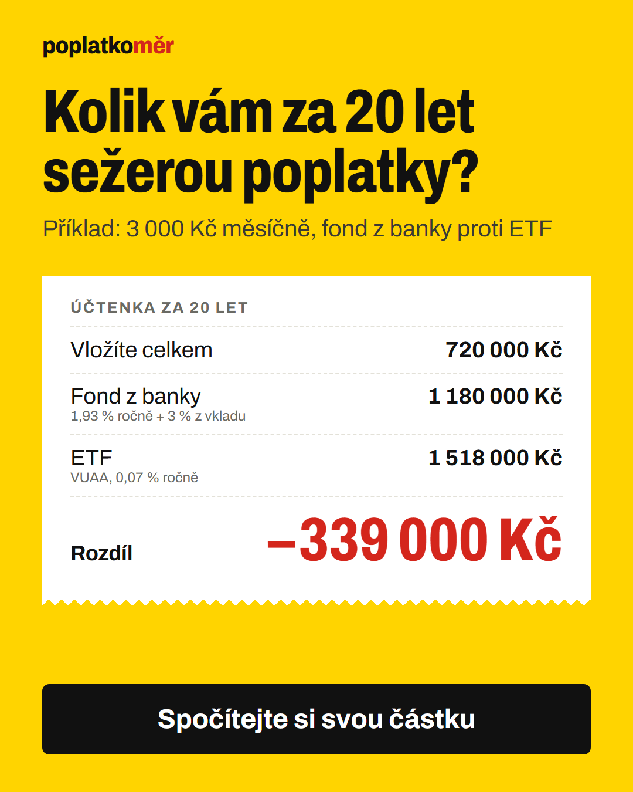
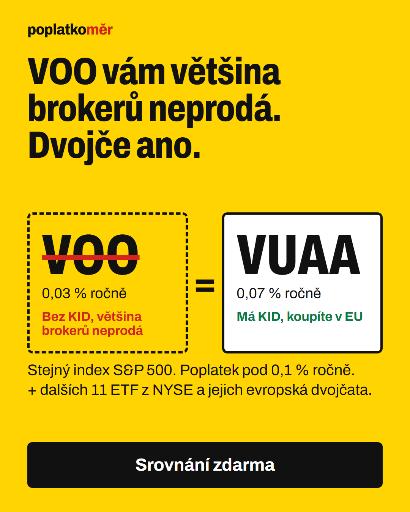

# Zadanie B — Poplatkoměr: lead magnet s porovnaním ETF z NYSE

Mobilná landing page pre českého drobného investora z reklamy. Návštevník
okamžite dostane hodnotu (výpočet, koľko ho stoja poplatky, a prvé 4 ETF),
za e-mail odomkne celé porovnanie 12 ETF z NYSE s ich európskymi „dvojčatami“
a tahák na 1 stranu.

```bash
cd zadanie-b
node server.mjs 4350          # http://localhost:4350  (?v=b = varianta „dvojča“, ?debug=1 = živý log udalostí)
node tools/funnel.mjs server-data/events.jsonl   # report lievika podľa variant
node tools/build-data.mjs     # research/etf-data.json → site/data.js (jediný zdroj čísel)
node tools/render-ads.mjs     # ads/*.html → PNG
```

Stránka **nie je nasadená** (rozhodnutie zadávateľa tohto cvičenia: iba lokálne).
Nasadenie na Vercel je pripravené — pozri [Nasadenie](#nasadenie).

---

## 1. Cieľová skupina

Český drobný investor, 25–45 rokov, na mobile, investuje alebo chce investovať
1 000 – 10 000 Kč mesačne. Na stránku príde z reklamy na Instagrame/Facebooku a
dá jej 3–5 sekúnd. Rozlišujem dva segmenty — každý má vlastnú reklamu a vlastný
prvý dojem stránky:

| Segment | Čo o ňom viem | Bolesť | Reklama → hero |
|---|---|---|---|
| **A: „Fond z banky“** | Investuje cez poradcu v banke do podielového fondu, o ETF počul, ale nevie, o koľko prichádza | Platí 1,5–2 % ročne + vstupný poplatok a nevie to vyčísliť | „Kolik vám za 20 let sežerou poplatky?“ → kalkulačka s účtenkou |
| **B: „Samouk z YouTube“** | Pozerá americký obsah, chce kúpiť VOO/SPY, broker mu to nedovolí | Nerozumie prečo, nevie, čo kúpiť namiesto toho | „VOO vám většina brokerů neprodá. Jeho dvojče ano.“ → VOO = VUAA |

**Dôležité rozhodnutie:** zadanie chce porovnanie ETF z NYSE. Český retail ich však
kvôli nariadeniu **PRIIPs** (americké ETF nevydávajú KID) u väčšiny brokerov
(DEGIRO, LYNX, Interactive Brokers…) **kúpiť nemôže** — výnimky existujú (agent
našiel, že Fio to podľa blogu Finhacker umožňuje), preto stránka hovorí „většina
brokerů“, nie „v Česku nekoupíte“. Stránka, ktorá by len porovnala VOO a SPY, by návštevníka
nasmerovala k produktu, ktorý si nekúpi — sklamanie, sťažnosti, nízka kvalita
leadov. Preto porovnávam ETF z NYSE (ako zadanie chce) **a ku každému pridávam
UCITS dvojča**, ktoré si kúpiť môže. Z problému sa tak stala hlavná hodnota
lead magnetu a háčik reklamy B.

## 2. Čo návštevník dostane a kedy žiadam kontakt

| Moment | Čo dostane | Za čo |
|---|---|---|
| **0–3 s** (hero) | Konkrétne číslo: koľko ho stojí fond z banky oproti ETF pri 3 000 Kč/mes. | zadarmo |
| **posunie posuvník** | Výpočet pre jeho sumu a 10/20/30 rokov | zadarmo |
| **scroll** | 4 najväčšie ETF z NYSE: poplatok, výnos 10 r., „v ČR nekúpite → dvojča“ | zadarmo |
| **zamknutých 8 ETF** | Zvyšok porovnania + všetky dvojčatá + tahák (daňový časový test, W-8BEN, DIP) + jeho výpočet | **e-mail** |
| **po odoslaní** | Okamžité odomknutie na stránke, tahák na stiahnutie, kópia e-mailom | — |
| **po odoslaní, voliteľne** | 1 otázka „kde investujete“ → ak „fond v banke“, ponuka bezplatného prepočtu telefonicky | telefón |

Kontakt žiadam **v momente najväčšej zvedavosti**: návštevník práve videl, že
4 ETF má zadarmo a ďalších 8 je rozmazaných priamo pod nimi. Hodnota je zrejmá
ešte pred formulárom (číslo v hero + otvorené ETF), formulár len odomyká zvyšok.

**Formulár = 1 pole (e-mail).** Súhlas s ďalšími e-mailmi je samostatný,
nepovinný, nezaškrtnutý checkbox (GDPR, zákon 480/2004 Sb.). Telefón a segment
zbieram až *po* konverzii (progressive profiling) — nebrzdia hlavný cieľ a
obchodne najcennejšie leady (peniaze vo fonde banky) sa samy označia.

**Ochrana konverzie vo formulári:** oprava preklepov v doméne jedným klikom
(`gmial.com` → `gmail.com`, `seznam.cy` → `seznam.cz`), honeypot proti botom,
klávesnica `type=email`, chybové hlásenia v češtine a bez mazania vstupu.

## 3. Poradie sekcií a prečo

**Varianta A (poplatky):**
1. **Hero + kalkulačka s účtenkou** — pokračuje presne tam, kde skončila reklama
   (rovnaký nadpis, žltá, účtenka). Prvá obrazovka = výsledné číslo, nie text o nás.
2. **Porovnanie ETF** — 4 otvorené, ostatné zamknuté. Prechod z „koľko strácam“
   na „čo si mám kúpiť“.
3. **Zámok s formulárom** — tam, kde návštevník narazí na hranicu hodnoty.
4. **FAQ** — odpovede na námietky, ktoré bránia odoslaniu (prečo nekúpim VOO,
   je to poradenstvo?, čo s e-mailom).
5. **Zdroje** — dôveryhodnosť (kto rozhoduje racionálne, pozrie si ich).

**Varianta B (dvojča)** mení poradie: hero s VOO = SPYL → porovnanie s
dvojčatami (to je jej sľub) → formulár → kalkulačka až potom (druhý argument).

Bez navigácie a odkazov preč (okrem zásad a zdrojov). Lepiace CTA dole sa
ukáže len vtedy, keď nie je vidno ani hero CTA, ani formulár.

## 4. Reklamy

Obe v [ads/](ads/): HTML zdroj + PNG 1080×1350 (feed 4:5, Meta). Texty, cielenie a
UTM: [ads/REKLAMY.md](ads/REKLAMY.md).

| A — poplatky | B — dvojča |
|---|---|
|  |  |

Čísla v reklamách sa počítajú z rovnakých dát a rovnakým vzorcom ako kalkulačka
na stránke (`site/data.js`) — reklama nikdy nesľúbi iné číslo, než aké návštevník uvidí.

## 5. Dáta a zdroje

Všetky čísla pochádzajú z [research/etf-data.json](research/etf-data.json), kde má
každý údaj URL zdroja a dátum. Skript `tools/build-data.mjs` z neho generuje
`site/data.js`, odkiaľ ich berie stránka, tahák aj reklamy. Zdroje sa zobrazujú
priamo na stránke (sekcia „Odkud jsou data“) a pri každom ETF. Zistenia,
rozpory medzi zdrojmi a čo sa nepodarilo overiť: [research/etf-notes.md](research/etf-notes.md).

## 6. Meranie celej cesty

Vlastné first-party meranie **bez cookies** (náhodné ID relácie žije len v
pamäti stránky → netreba cookie lištu, meriame 100 % návštev, nie len tých, čo
klikli „súhlasím“). Udalosti idú na `/api/e` a súčasne do `dataLayer` pre GTM.
Meta pixel / GTM sa načítajú až po súhlase (lišta sa zobrazí, len ak sú ID
vyplnené v `site/config.js`); udalosť `Lead` ide do pixelu pre optimalizáciu kampane.

| Udalosť | Kedy |
|---|---|
| `page_view` | príchod (+ UTM, varianta, referrer, šírka) |
| `engaged_10s`, `scroll_depth` 25/50/75/100 | pozornosť |
| `section_view` | sekcia prešla stredom obrazovky (hero, calc, compare, form, faq, sources) |
| `calc_interact`, `calc_change` | prvé použitie kalkulačky, zvolená suma a výsledok |
| `etf_open`, `locked_click` | rozkliknutie ETF, klik na zamknutý ETF |
| `hero_cta`, `sticky_cta`, `faq_open` | kliky |
| `form_view`, `form_start`, `form_error` (kód), `lead` | formulár |
| `newsletter_optin`, `post_survey`, `phone_offer_view`, `phone_submit`, `tahak_open` | po konverzii |
| `page_exit` | odchod (čas, max. scroll, či konvertoval) |

`tools/funnel.mjs` z toho skladá lievik podľa variant: príchod → videl formulár
→ začal písať → lead, ďalej čo sa dialo po leade a **konverziu tých, čo použili
danú interakciu, oproti tým, čo nie** (napr. konvertujú viac ľudia po kalkulačke?).

## 7. Očakávaná konverzia

Benchmark: medián konverzie landing pages naprieč odvetviami je **6,6 %**, pri
finančných službách **~8,4 %** (Unbounce Conversion Benchmark Report 2024,
41 000 stránok; čísla cez sekundárne zdroje). Ide o priemer zo všetkých zdrojov
návštevnosti — studený mobilný traffic zo sociálnych sietí konvertuje horšie
než vyhľadávanie. Môj odhad pre túto stránku:

| Krok (z 100 klikov na reklamu) | Odhad | Prečo |
|---|---|---|
| Stránka sa načíta a návštevník neodíde do 3 s | 60–70 | mobil + reklama; stránka má ~25 kB JS/CSS, bez frameworku |
| Uvidí formulár (scroll alebo CTA) | 30–40 | CTA v hero vedie priamo k zámku |
| Začne písať e-mail | 12–15 | |
| **Odošle (lead)** | **6–9** | jedno pole, hodnota už videná |

**Základný odhad: 7 % kliknutí → e-mail** (pesimisticky 4 %, optimisticky 12 %).
Z leadov odhadom 40–50 % odpovie na anketu, 10–20 % z nich zvolí „fond v banke“
a štvrtina z nich nechá telefón → **≈ 1–2 % leadov s telefónom** (najcennejšie).
Cena za lead = CPC / konverzia; pri CPC 10 Kč a 7 % ≈ 140 Kč (CPC je predpoklad,
treba ho zmerať prvé 2–3 dni kampane).

## 8. Tri hypotézy na A/B test (podľa očakávaného dopadu)

1. **Uhol správy: „poplatky“ vs. „dvojča“** (reklama A + hero A vs. reklama B +
   hero B, už pripravené cez `?v=`). Najväčší dopad, lebo mení CTR reklamy aj
   konverziu stránky naraz a oslovuje iný segment. *Metrika:* cena za lead
   (nie len konverzia stránky). *Očakávanie:* rozdiel 30–50 % v CPL.
2. **Moment žiadosti: formulár hneď pod účtenkou v hero** („Pošleme vám výpočet
   a srovnání“) vs. zámok pod 4 ETF. Formulár by videlo ~2× viac ľudí, ale za
   cenu menej videnej hodnoty. *Metrika:* lead / príchod a kvalita (otvorenosť
   e-mailov). *Očakávanie:* +15–30 % leadov.
3. **Rámec ponuky: „Odemknout srovnání“ vs. „Osobní tahák: co koupit u vašeho
   brokera“** (+ výber brokera pred formulárom). Personalizácia zvyšuje vnímanú
   hodnotu. *Očakávanie:* +10–20 %.

Minimálna veľkosť testu: pri základnej konverzii 7 % a cieľovom rozdiele +20 %
relatívne (7 % → 8,4 %) treba ~5 700 návštev na variantu (α = 0,05, sila 80 %).
Pri menšom rozpočte testovať najprv hypotézu 1 — jej očakávaný rozdiel je najväčší,
takže stačí menšia vzorka.

## 9. E-maily po odoslaní (návrh sekvencie)

D0 tahák + odkaz na celé porovnanie · D2 „Jak koupit první ETF u brokera krok
za krokem“ · D5 „Daně: časový test a W-8BEN“ · D9 „Jak odejít z fondu v bance
(výstupní poplatky, kdy se to vyplatí)“ · D14 ponuka konzultácie / partnera.

## 10. Nasadenie

```bash
npm i -g vercel
cd zadanie-b && vercel --prod
```
`api/*.js` sú Vercel Functions v rovnakom formáte, aký používa lokálny
`server.mjs`. Na Verceli je disk len na čítanie → nastaviť `LEAD_WEBHOOK_URL`
(a voliteľne `EVENTS_WEBHOOK_URL`), napr. na Make/Zapier → Google Sheet, alebo
priamo na e-mailingový nástroj (Ecomail, Brevo). Do `site/config.js` doplniť
`metaPixelId` / `gtmId`.

## 11. Čo chýba / čo by som pred spustením reklamy ešte urobil

- **Prevádzkovateľ a zásady** — doplniť názov, IČO a nechať právne skontrolovať
  `zasady.html` a texty o ETF (nie investičné odporúčanie).
- **Napojenie e-mailingu** (Ecomail/Brevo) a odoslanie taháku e-mailom — teraz
  sa ukladá len lead, e-mail sa reálne neodosiela.
- **Overenie dostupnosti dvojčiat u konkrétnych brokerov** (XTB, Trading 212,
  Fio…) — dáta hovoria, na ktorej burze sú, nie u ktorého brokera.
- **Aktualizácia dát** — poplatky a výnosy sa menia; `build-data.mjs` treba
  spúšťať mesačne (výnosy sú k dátumu uvedenému na stránke).
- **Rýchlosť**: font Archivo z Google Fonts (~40 kB); pri kampani by som ho
  hostoval sám a predpripojil.
